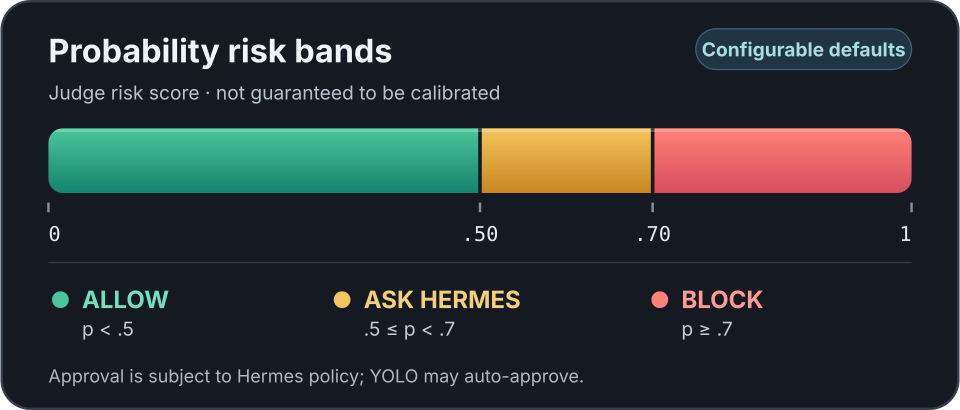

# One Guard 🛡️

A native [Hermes](https://hermes-agent.nousresearch.com) plugin that asks an LLM judge before the agent is allowed to run a tool. If the judge isn't sure, the tool call gets blocked.

The scenario I actually care about: you point Hermes at a local model, and that model - maybe because of a bad training-data artifact, maybe because someone baked it in - tries to `POST` your credentials to some random bucket. One Guard sits in front of that and says "nope" 🛑

```sh
git clone git@github.com:HumanFace-Tech/one-guard.git
cd one-guard
sh ./install.sh
```

That's it. The installer opens a small wizard, asks a handful of questions, shows you what it's about to do, and writes nothing until you confirm. After authentication, it offers an optional model-list lookup; it tells you whether the credential it selected will be sent, warns you when a remote plaintext endpoint would carry it unencrypted, and asks before contacting the judge. You can skip it and enter a model yourself. On an interactive color terminal, it can also ask permission to download pinned packages for arrow-key menus into a temporary isolated environment. Say no, or use the plain wizard, to avoid that download. Stop Hermes first, restart it after.

The model list is whatever the judge reports, not proof that a model supports your chosen protocol. For System One, native-decision capability is shown only when the server reports it; otherwise it is unknown. Identifiers that contain your credential are never offered or stored. `--yes` never opens the wizard or contacts the judge for discovery. See [the installation guide](docs/installation.md) for request and privacy details.

## What It Actually Does

One Guard registers a single `pre_tool_call` hook. Every tool Hermes wants to run - terminal commands, HTTP requests, file writes, MCP tools - goes through it first.

The judge gets the tool name and the full arguments, and answers in one of two modes:

-   **Yes / no** - `yes` means risk and blocks, `no` means safe and allows.
-   **Probability** - a risk score from 0 to 1. By default, scores below `0.50` allow, scores from `0.50` to below `0.70` request Hermes approval, and scores at or above `0.70` block.



**Approval is subject to Hermes policy; YOLO may auto-approve.** Hermes settings such as `approvals.mode: off`, unattended approval modes, or persistent allowlists can approve a call without a human prompt. Yes/no mode remains strictly binary and never requests approval. Errors or unusable judge responses block in either mode. These default cutoffs are policy thresholds, not a claim that the judge's scores are calibrated probabilities.

When you remember an approval, it covers that one tool proposal. One Guard names its own approval rule, so a remembered answer applies to the exact call you approved and not to later calls for the same tool. That naming only scopes the answer when One Guard's own approval is the one the host keeps: Hermes takes the first valid approval request of a call, so a peer plugin that asks first takes precedence and its rule is the one remembered.

Anything else blocks. A malformed response, a timeout, an unreachable judge, a model that rambles instead of answering - all of it denies. I went with fail-closed on purpose: for a security gate, "I don't know" should mean "no" 🤔

## The Judge

Any OpenAI-compatible endpoint works. There's also support for the native llama.cpp `/v1/systemone` decision API, which is what the `h2o-lightning-4b` model speaks - that one gives you a proper Noul probability instead of a number the model made up.

An earlier smoke run against a local `h2o-lightning-4b` matched 11 of 12 of my own expected labels, including denying the exact command from a published agent incident - and it *missed* one: a proposal to delete the guard itself. Those labels are my guesses, not ground truth, and the run does not validate the current probability cutoffs. Treat this as a useful layer, not a wall 🧱

Details, settings, and the full request/response contract live in [docs/configuration.md](docs/configuration.md).

## What It Doesn't Do

I want to be straight about this, because "AI security guard" invites the wrong assumptions.

-   **It's not a sandbox.** It judges what Hermes proposes to do. It doesn't see what happens inside a tool, and it can't stop a process that's already running.
-   **It doesn't read hidden scripts.** If the agent says `sh /tmp/whatever.sh`, the judge sees that string - not the file. Inline scripts get judged in full.
-   **Other plugins are trusted.** If some extension rewrites a tool call *after* One Guard has approved it, the rewritten version never gets judged. I deliberately didn't try to block that - it would mean patching Hermes internals, and the complexity wasn't worth it. More in [docs/threat-model.md](docs/threat-model.md).
-   **The judge can be wrong.** It's an LLM reading untrusted input. A good judge, a bad judge, and a jailbroken judge all exist.

For real exfiltration prevention you still want network egress controls and process isolation. One Guard is the cheap, fast layer on top.

## Configuration

Everything's in the wizard, and you can edit any of it from the review screen before it writes anything. The short version:

| Setting | Default | What it does |
| --- | --- | --- |
| `protocol` | `chat_completions` | `chat_completions` or `systemone` |
| `endpoint` | `http://127.0.0.1:8080/v1/chat/completions` | The judge URL. Path has to match the protocol |
| `judge_model` | `""` | Model name, if your endpoint needs one |
| `mode` | `yes_no` | `yes_no` or `probability` |
| `timeout` | `5.0` | Seconds, up to 120 |
| `approval_threshold` | `0.5` | Risk score at or above this requests Hermes approval (probability mode only) |
| `threshold` | `0.7` | Risk score at or above this blocks (probability mode only) |
| `token` | `""` | Optional bearer token, stored in Hermes `.env` |

There's a full table, the environment variable names, and the exact parsing rules in [docs/configuration.md](docs/configuration.md). If an existing configuration sets `threshold` but omits `approval_threshold`, it retains the legacy two-band behavior: scores below the threshold allow, and scores at or above it block. The wizard writes both settings. It can optionally request one bounded `GET /v1/models` from the configured judge origin; it does not follow redirects or pagination and does not download models. Over remote plaintext HTTP, the credential sent for discovery is unencrypted, and the consent screen says so. Runtime judge requests also send tool arguments, so use HTTPS for remote endpoints.

One thing worth knowing: Hermes has its own separate hook timeout (30s by default) that caps the plugin regardless. If your judge is slow - mine took ~20s per call - you'll need to raise that in Hermes' `config.yaml` too. The installer warns you but won't touch it, since it's a global setting ⚙️

## Non-Interactive Install

If you'd rather not answer questions:

```sh
ONE_GUARD_TOKEN='your-token' sh ./install.sh --yes \
  --hermes-dir /path/to/hermes-agent \
  --hermes-home "$HOME/.hermes" \
  --protocol systemone \
  --endpoint http://your-judge:8080/v1/systemone \
  --model h2o-lightning-4b \
  --response-mode probability \
  --timeout 60 \
  --allow-insecure-http
```

`--allow-insecure-http` sends your bearer token and tool arguments **unencrypted** - only use it on a network you trust, and prefer HTTPS for anything else. Set `ONE_GUARD_TOKEN` if your judge needs a bearer token; without it, `--yes` installs without one and never prompts.

All flags are in [docs/installation.md](docs/installation.md), along with the credential handling and the update/uninstall steps.

## Testing Against Your Own Judge

There's an opt-in script that sends inert proposals to a judge you point it at. It never runs the proposals and never contacts the destinations embedded in them:

```sh
python3 scripts/smoke-systemone.py --run-live \
  --endpoint http://your-judge:8080/v1/systemone \
  --model h2o-lightning-4b \
  --allow-insecure-http \
  --response-mode probability --timeout 60
```

The `--timeout 60` matters if your judge is slow - the default is 5 seconds, and mine takes ~20 per call.

There's a second one built from a published agent-incident trace, if you want to see how your judge handles real-world-shaped cases. Details in [docs/verification.md](docs/verification.md).

For a broader check, there's also a set of **100 original synthetic cases**, including 50 benign controls. It reports false blocks separately from approval requests - see [docs/evaluation.md](docs/evaluation.md). These are test cases, not proof of real-world accuracy.

## Requirements

-   Python 3.10+ and a POSIX shell
-   Hermes, obviously
-   PyYAML and python-dotenv in the active Python or in Hermes' `.venv` - these must already be installed; the installer does not install them
-   For the optional arrow-key menus, either `prompt_toolkit` already available or your consent to download pinned UI packages into a temporary isolated environment. Without consent or when the UI is unavailable, the numbered wizard works without those packages

The plugin runtime is pure standard library - no runtime dependencies, no model downloads, no inference server. The optional UI download is only for the installer's terminal menus: its temporary environment is removed on exit and it does not modify Hermes or system Python. The installer still requires PyYAML and python-dotenv to pre-exist in the active Python or Hermes' `.venv`.

## Development

```sh
python3 -m unittest discover -s tests -p 'test_*.py' -v
```

The suite covers the plugin runtime, the Hermes runtime integration, the installer, the wizard, and the installer driven through a real pseudo-terminal. Hermes integration tests need a checkout pointed at with `HERMES_SOURCE` and skip without it.

[AGENTS.md](AGENTS.md) is the maintainer reference. [docs/adr/](docs/adr/README.md) has the design decisions, [docs/research.md](docs/research.md) the upstream evidence, and [docs/verification.md](docs/verification.md) what was actually executed and observed.

## License

Not set yet - I'll add one before calling this properly open source. Shout if you want a specific one.
